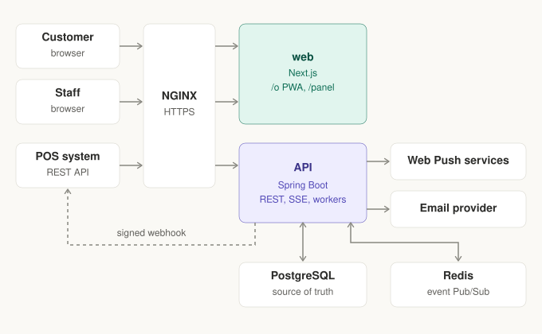
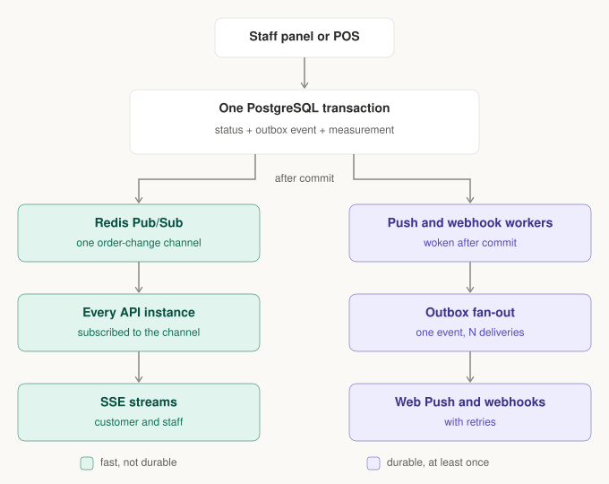

# Kairos

A virtual pager for restaurants. Customers scan a QR code to follow their
order without an account or app; staff manage orders in the panel, and
point-of-sale systems integrate through a REST API and webhooks. Everything is
served from one origin.

* `apps/web`: Next.js application: landing page, customer PWA under `/orders`, staff
  panel under `/panel`
* `apps/api`: Spring Boot API under `/api`

## Architecture



### Order status notifications



## Running locally

Requires [Docker](https://docs.docker.com/get-docker/) with Compose 2.30+ and OpenSSL.

```bash
make dev
```

Customer app: http://localhost:3000/orders, panel: http://localhost:3000/panel,
API: http://localhost:8080/api. More in [local development](docs/agents/local-development.md).

## Documentation

* [Problem description](docs/PROBLEM_DESCRIPTION.md)
* [Requirements and architecture](docs/REQUIREMENTS.md)
