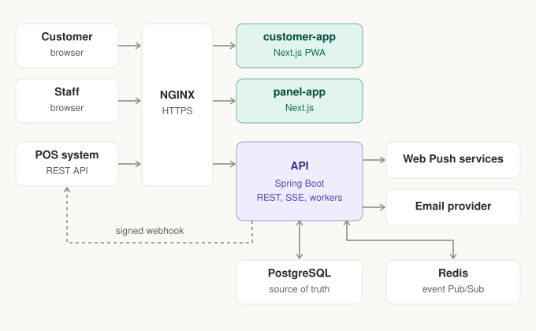
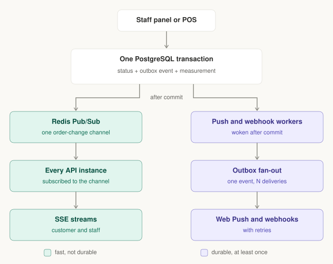

# Kairos

Kairos is a virtual pager system for restaurants. Customers scan an
order-specific QR code to follow its status without creating an account or
installing an app. Restaurant staff manage orders through a separate
authenticated panel.

The system consists of three applications:

* `apps/customer-app` — customer-facing Next.js PWA
* `apps/panel-app` — staff Next.js panel
* `apps/api` — Spring Boot API

## Architecture



### Order status notifications



## Local development

Install [Docker](https://docs.docker.com/get-docker/) with Compose 2.30 or newer and OpenSSL, then run:

```bash
./setup.sh --dev
```

This prepares configuration and keys and starts all five services in Docker with
hot reload (customer app on http://localhost:3000, panel on http://localhost:3001,
API on http://localhost:8080/api). First login, daily commands, logs, resetting
and Web Push limits are in
[local development](docs/agents/local-development.md). Production from a source
checkout is described in [production configuration](docs/deployment/CONFIGURATION.md);
hosted releases use the [production runbook](docs/deployment/RUNBOOK.md).

## Hosted VM preparation

For a repeatable Ubuntu 24.04 x86-64 host setup, follow the
[VM bootstrap guide](docs/deployment/BOOTSTRAP.md). It installs host dependencies and
prepares persistent application keys without starting Kairos.

## Repository checks

Frontend and backend check commands are listed in [validation](docs/agents/validation.md).

## Documentation

* [Agent instructions and development workflow](AGENTS.md)
* [Problem description](docs/PROBLEM_DESCRIPTION.md)
* [Product requirements and architecture](docs/REQUIREMENTS.md)
* [Public production operations](docs/deployment/RUNBOOK.md)
